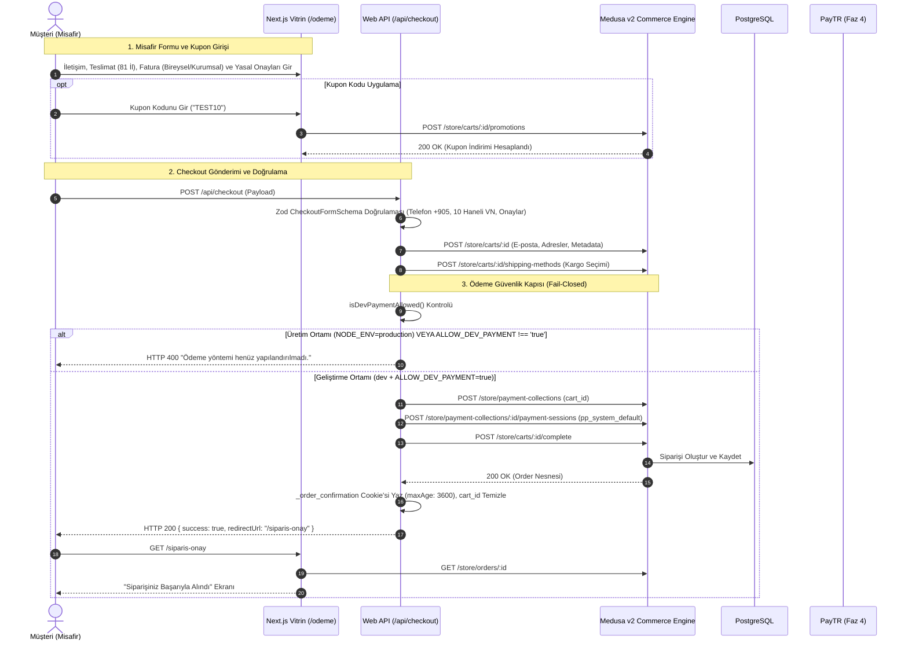

# Misafir Checkout, Promosyon ve Sipariş Onay Akışı (CHECKOUT_FLOW.md)

Bu doküman, Alte platformunda kullanıcının sepet oluşturmasından başlayıp misafir checkout (`/odeme`), kupon uygulama, yasal onaylar, geliştirme ortamı ödeme güvenlik kapısı ve sipariş onayı (`/siparis-onay`) adımlarına kadar uçtan uca mimarisini açıklar.

---

## 1. Uçtan Uca Mermaid Sıra Diyagramı (Faz 3 & Faz 4 Entegre)

---

## 2. Form Mimarisi ve Türkiye Mevzuatı Kuralları

1. **İletişim & Telefon Normalizasyonu (`normalizeTurkishPhone`):**

   - Türkiye mobil cep numaraları E.164 standardına (`+905XXXXXXXXX`) dönüştürülür.
   - 05XX, 5XX, +905XX, 00905XX formatları kabul edilir; sabit hatlar (0212, 0312 vb.) ve yabancı formatlar reddedilir.

2. **81 İl Seçim Listesi (`TURKISH_CITIES`):**

   - Türkiye Cumhuriyeti'nin resmi 81 ili alfabetik sıralı ve benzersiz olarak sunulur. Serbest metin il girişine izin verilmez.

3. **Fatura Türü ve Bilgileri (Bireysel / Kurumsal):**

   - **Bireysel Fatura:** Teslimat adresiyle aynı seçeneği (varsayılan) veya ayrı fatura adresi.
   - **Kurumsal Fatura:** Şirket Resmi Unvanı, Vergi Dairesi ve tam 10 haneli Vergi Numarası (`CorporateTaxNumberSchema`) zorunludur.
   - **ÖNEMLİ (KVKK / Veri Minimizasyonu):** Bireysel ve kurumsal hiçbir faturada **TC Kimlik Numarası toplanmaz ve talep edilmez.**

4. **Yasal Onaylar ve Audit Zaman Damgaları:**

   - Mesafeli Satış Sözleşmesi ve Ön Bilgilendirme Formu (`/sayfa/mesafeli-satis-sozlesmesi` linkli).
   - KVKK Aydınlatma Metni (`/sayfa/kvkk` linkli).
   - Sipariş onayında her iki onay zorunludur ve Medusa cart metadata alanında ISO-8601 zaman damgasıyla saklanır:
     `distance_sales_contract_consent_at`, `kvkk_consent_at`.

5. **Çift Gönderim Koruması (Double-Submit Protection):**
   - Form gönderimi sırasında buton devre dışı kalır (`disabled`), spinner animasyonu gösterilir ve mükerrer istek gönderilmesi engellenir.

---

## 3. Promosyon ve Kupon Sistemi (Medusa v2)

- **Endpoint:** `POST /store/carts/:id/promotions` ve `DELETE /store/carts/:id/promotions`
- **Kupon Kodları (Idempotent Seed):**
  - `TEST10`: Yüzde 10 indirim
  - `TEST50TL`: 50 TL sabit tutar indirimi
- **Hata Yönetimi:** Geçersiz veya süresi dolmuş kuponlarda kullanıcıya dostça Türkçe mesaj döndürülür: `"Geçersiz veya süresi dolmuş kupon kodu."`

---

## 4. Ödeme Güvenlik Kapısı (Production Payment Guard)

- `isDevPaymentAllowed()`:
  - `process.env.NODE_ENV !== "production" && process.env.ALLOW_DEV_PAYMENT === "true"`
- **Fail-Closed:** Üretimde sahte ödeme (`pp_system_default`) ile sipariş oluşturulması hem Medusa uygulama seviyesinde (Payment Guard loader) hem de Next.js vitrin checkout API'sinde engellenmiştir.

---

## 5. Sipariş Tamamlama ve Çerez Yaşam Döngüsü

1. Sipariş başarıyla oluşturulduğunda:
   - `cart_id` çerezi silinir.
   - `_order_confirmation` adında 1 saatlik (maxAge 3600) güvenli `httpOnly`, `sameSite: "lax"` çerez yazılır.
2. `/siparis-onay` sayfası:
   - `_order_confirmation` çerezini okur; çerez yoksa veya sipariş bulunamazsa doğrudan `/` ana sayfaya yönlendirir.
   - Sipariş detaylarını Medusa'dan çeker; Sipariş No (`display_id`), kalemler, birim fiyatlar, KDV (%20), kargo, indirim ve genel toplamı TL cinsinden görüntüler.
