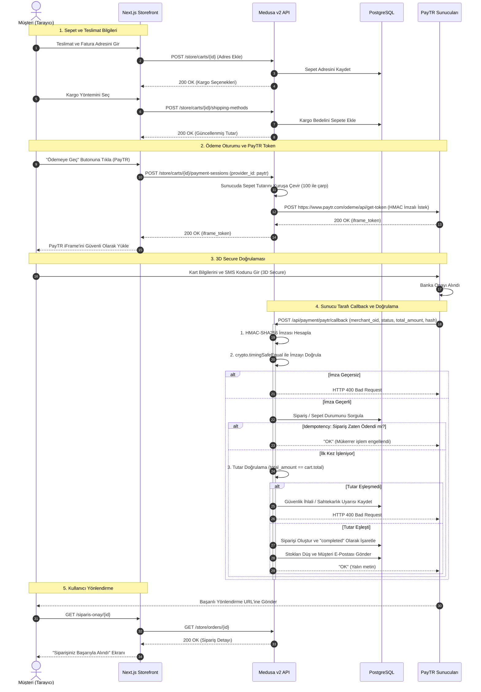

# Ödeme ve Sipariş Akışı (CHECKOUT_FLOW.md)

Bu doküman, müşterinin sepet oluşturmasından başlayıp PayTR üzerinden 3D Secure doğrulaması ve sunucu callback'i ile siparişin tamamlanmasına kadar geçen tüm yaşam döngüsünü açıklar.

---

## 1. Uçtan Uca Mermaid Sıra Diyagramı

---

## 2. Kritik Güvenlik ve Bütünlük Kontrolleri

1. **HMAC-SHA256 Bütünlük Doğrulaması:**
   Callback isteğindeki `hash`, sunucu tarafındaki gizli anahtarlar ile doğrulanmadan hiçbir sipariş durumu değiştirilemez.
2. **Sabit Zamanlı Karşılaştırma (`timingSafeEqual`):**
   Karakter bazlı erken sonlanan dizi karşılaştırmaları, saldırganın milisaniyelik gecikmeleri ölçerek geçerli imzayı tahmin etmesine (timing attack) olanak tanır. Bu nedenle Node.js `crypto.timingSafeEqual()` fonksiyonu kullanılır.
3. **Kuruş Seviyesinde Tutar Karşılaştırması:**
   PayTR'nin ilettiği `total_amount` (örn: `15990` = 159.90 TL), Medusa veritabanında saklanan sepet tutarı ile kuruşu kuruşuna eşit olmak zorundadır.
4. **Idempotency (Tekrarlayan İstek Yönetimi):**
   Ağ kesintilerinde PayTR bildirimleri yeniden gönderilebilir. Callback işleyicisi `merchant_oid` ile eşleşen siparişin daha önce onaylanıp onaylanmadığını kontrol eder; zaten onaylanmışsa stokları tekrar düşmez, yalnızca `"OK"` cevabı verir.
5. **Kesin `"OK"` Yanıtı:**
   PayTR protokolüne göre sunucudan dönen metin tam olarak `"OK"` olmalıdır. HTML etiketleri veya JSON dönülürse PayTR ödemeyi başarısız sayarak saatlerce webhook göndermeye devam eder.
