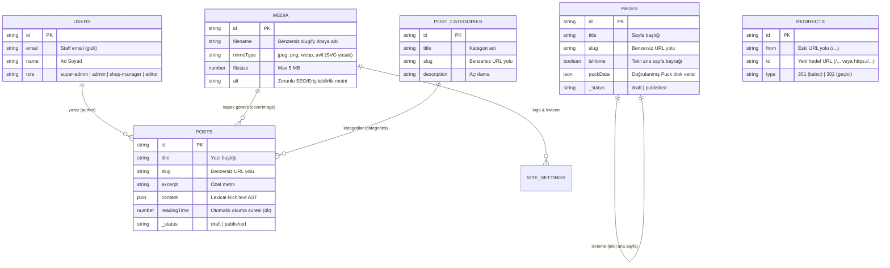

# İçerik Modeli ve Payload CMS Koleksiyonları (Content Model)

Bu doküman, Alte CMS monoreposunda Payload CMS 3 üzerinde kurgulanan içerik mimarisini, koleksiyonları, globalleri ve veri ilişkilerini açıklamaktadır.

---

## 1. Varlık İlişki Diyagramı (Entity-Relationship Diagram)

---

## 2. Koleksiyon Detayları

### 2.1. Pages (Sayfalar)

- **Taslak Yönetimi (Drafts)**: Etkin. Yayınlanmamış taslaklar arama motorlarına ve ziyaretçilere kesinlikle kapalıdır (404 döner).
- **isHome Kontrolü**: Bir sayfa `isHome: true` olarak işaretlendiğinde, veritabanındaki diğer tüm sayfaların `isHome` değeri `beforeChange` hook'u ile otomatik kaldırılır.
- **Puck Verisi**: `puckData` alanı Zod şeması ile sunucuda doğrulanır (max 512 KB, max 200 bileşen, max 6 derinlik).
- **SEO Grubu**: `metaTitle` (60 krk önerisi), `metaDescription` (160 krk önerisi), `ogImage`, `canonicalUrl` (safeHref kontrollü), `noIndex` bayrağı.

### 2.2. Posts (Blog Yazıları)

- **İçerik Editörü**: Lexical zengin metin düzenleyici (başlıklar, listeler, alıntılar, görsel ve güvenli linkler).
- **Okuma Süresi (readingTime)**: Kelime adedine göre (~200 kelime/dk, en az 1 dk) hook aracılığıyla otomatik hesaplanır.
- **Yazar İlişkisi (Author)**: `Users` koleksiyonuna bağlıdır. Field-level erişim kontrolü sayesinde ziyaretçilere yalnızca yazarın adı (`author.name`) döner; e-posta (`author.email`) vitrine veya açık REST uçlarına **asla sızmaz**.

### 2.3. PostCategories (Blog Kategorileri)

- Blog yazılarını tematik olarak gruplar (örn: _Stil Rehberi_, _Kumaş & Bakım_, _Koleksiyon Hikayeleri_).
- Otomatik slug üretimi (`beforeValidate`).

### 2.4. Redirects (Yönlendirmeler)

- `from`: Tek bir `'/'` ile başlamak zorundadır.
- `to`: İç bağlantı (`/...`) veya güvenli dış bağlantı (`https://...`).
- **Döngü Koruması**:
  - Kendine yönlendirme ($A \to A$) kesinlikle engellenir.
  - Çok adımlı döngüsel zincirler ($A \to B \to C \to A$) `isCircularRedirect` hook'u ile algılanır ve kaydetme reddedilir.

---

## 3. Globals Detayları

### 3.1. SiteSettings (Site Ayarları)

- `storeName`: Varsayılan: `"Çisem Elif Boz"`.
- `storeDescription`: Mağaza tanıtım sloganı.
- `contactEmail`, `contactPhone`, `address`.
- `logo`, `favicon`: Media koleksiyonuna bağlı raster görseller.
- `socialMedia`: Instagram, Facebook, X (Twitter), YouTube güvenli bağlantıları.
- **Erişim**: Yalnızca `admin` ve `super-admin` güncelleyebilir; `editor` güncelleyemez.

### 3.2. Navigation (Menü & Navigasyon)

- `headerMenu`: Üst gezinme bağlantıları ve opsiyonel 2. seviye alt menü öğeleri.
- `footerMenu`: Kolon başlıklı alt menü grupları (örn: Kurumsal, Kategoriler).
- **Bağlantı Doğrulaması**: Tüm bağlantılar `validateSafeHrefField` ile denetlenir.
- **Erişim**: Yalnızca `admin` ve `super-admin` güncelleyebilir; `editor` güncelleyemez.
