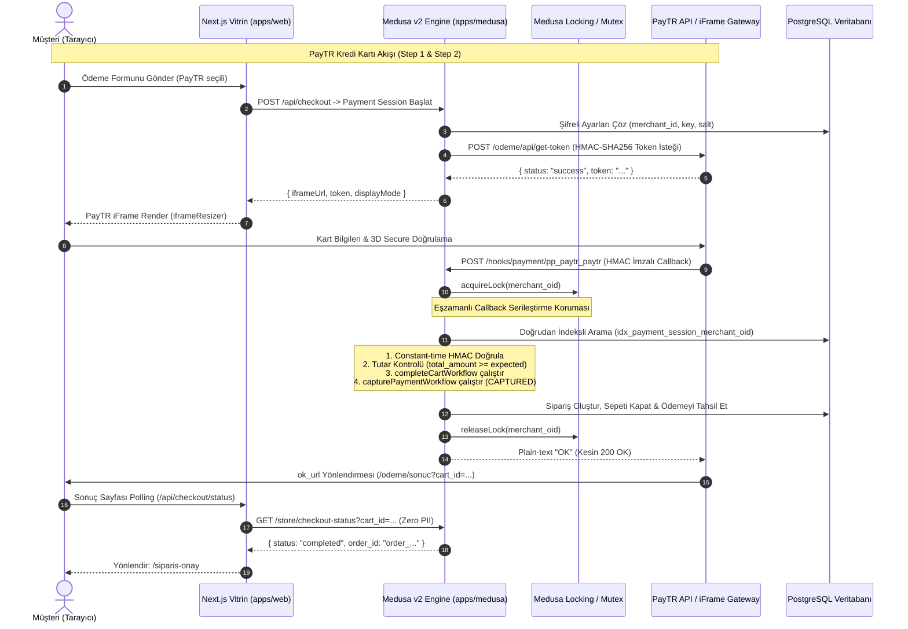

# Alte E-Ticaret Ödeme Mimarisi (PayTR & Kapıda Ödeme)

Bu doküman, Alte CMS e-ticaret platformunda yer alan ödeme sağlayıcılarının mimarisini, veri akışlarını, şifreleme mekanizmalarını, eşzamanlılık kontrolünü ve güvenlik korumalarını açıklar.

---

## 1. Mimariye Genel Bakış

Sistem, Medusa v2'nin modüler Payment Provider mimarisi üzerine kuruludur. İki temel ödeme sağlayıcısı ve geliştirici ortamı için bir fallback sağlayıcı mevcuttur:

1. **PayTR Sağlayıcısı (`pp_paytr_paytr`):**

   - **Tip:** iFrame ve Yönlendirmeli (Redirect) Kredi/Banka Kartı Ödemesi.
   - **Akış:** İki adımlı güvenli ödeme (Step 1: Sunucu taraflı Token alma, Step 2: PayTR Webhook Callback).
   - **Destek:** Peşin ve Taksitli ödeme (admin panelinden taksit üst sınırı ayarlanabilir).
   - **Çevre:** Sandbox (Test) ve Canlı (Production) modları admin panelinden dinamik olarak yönetilir.
   - **Tahsilat (Capture):** Başarılı webhook bildiriminde ödeme derhal `capturePaymentWorkflow` ile tahsil edilir (`captured_at` dolar, `paid_total = total`).

2. **Kapıda Ödeme Sağlayıcısı (`pp_cod_cod`):**

   - **Tip:** Teslimatta Nakit / Kredi Kartı ile Ödeme (Cash on Delivery).
   - **Kalıcı Satır Kalemi:** Özel hizmet ürünü ("Kapıda Ödeme Hizmet Bedeli", SKU: `SERVICE-COD-FEE`, metadata: `{ is_cod_fee: true, hidden: true }`) sepete sunucu tarafında eklenir; başka ödeme yöntemine geçildiğinde derhal kaldırılır.
   - **Vergi & Birim:** Fiyatlar KDV dahil (%20) ve standart TL birimi (decimal/float) cinsindendir.
   - **Eşik Hesaplamaları:** 1500 TL ücretsiz kargo eşiği ve `cod_max_order_amount` üst sınırı YALNIZCA asıl ürün satırları toplamı üzerinden hesaplanır; hizmet bedeli eşik hesaplamalarına dahil edilmez.
   - **Üst Limit:** Risk yönetimi amacıyla maksimum sepet tutarı sınırı (örn. 5.000 TL).

3. **Geliştirici Sahte Ödeme (`pp_system_default`):**
   - **Kısıtlama:** Yalnızca `NODE_ENV !== "production"` ve `ALLOW_DEV_PAYMENT="true"` iken vitrinde aktifleşebilir.
   - **Üretim Başlatma Koruması (Startup Guard):** Medusa açılışında `productionPaymentGuard` loader'ı tarafından `region_payment_provider` tablosu taranarak kontrol edilir. Üretimde herhangi bir bölgeye `pp_system_default` bağlıysa veya hiçbir bölgeye gerçek sağlayıcı (`pp_paytr_paytr`, `pp_cod_cod`) bağlı değilse sunucu fail-closed olarak `exit 1` ile kapanır.

---

## 2. Veri ve Ödeme Akış Şeması (Mermaid)

---

## 3. Güvenlik, Şifreleme ve Dayanıklılık Mimarisi

### 3.1 Üretim Başlatma Koruması (Fail-Closed Production Guard)

`apps/medusa/src/loaders/production-payment-guard.ts` ve `apps/medusa/src/modules/payment-guard/service.ts`:

- Medusa ayağa kalkarken `NODE_ENV === "production"` durumunu inceler.
- Bölge-sağlayıcı bağlantılarını `region_payment_provider` tablosundan sorgular.
- Eğer herhangi bir bölgeye `pp_system_default` bağlıysa derhal `process.exit(1)` vererek durdurur.
- Eğer hiçbir bölgeye gerçek sağlayıcı (`pp_paytr_paytr` veya `pp_cod_cod`) bağlı değilse derhal `process.exit(1)` vererek durdurur.
- Üretimde `PAYTR_API_BASE` veya `DEV_PAYTR_USER_IP` tanımlanmışsa `assertUndefinedInProduction` kuralıyla `process.exit(1)` verir.
- Sadece PayTR ve/veya COD bağlıysa `[Payment Guard] Production payment guard PASSED` loglar ve sunucu açılır.

### 3.2 AES-256-GCM ile Veri Güvenliği

PayTR Merchant Key, Merchant Salt ve gelecekteki hassas kimlik bilgileri veritabanında asla açık metin (plaintext) olarak saklanmaz:

- **Algoritma:** `AES-256-GCM` (Kimlik doğrulamalı simetrik şifreleme).
- **Anahtar Türetme:** `SETTINGS_ENCRYPTION_KEY` ortam değişkeni (32 byte hex veya base64 string).
- **Format:** `iv:ciphertext:tag` (Her kayıt için 12-byte rastgele IV ve 16-byte GCM authentication tag).
- **Bütünlük Koruması:** Veritabanındaki şifreli metin harici müdahaleye uğrarsa, GCM tag doğrulaması hata verir ve fail-closed davranır.

### 3.3 Eşzamanlılık Kilidi (Concurrency Locking & Mutex)

- PayTR aynı `merchant_oid` için eşzamanlı olarak birden fazla webhook çağrısı yapabilir.
- `apps/medusa/src/api/hooks/payment/pp_paytr_paytr/route.ts` içinde `executeWithLock` fonksiyonu kullanılır.
- Medusa Locking Modülü (`Modules.LOCKING`) öncelikli olarak kullanılır; bulunamadığı durumlarda promise tabanlı in-memory mutex devrededir.
- Kilit mekanizması sayesinde eşzamanlı 5 callback dahi gelse işlemler sıraya alınır; ilk işlem sepeti siparişe dönüştürüp ödemeyi tahsil ederken, sonraki işlemler sepetin ve oturumun tamamlandığını görerek güvenle `200 OK` döner (çift sipariş ve çift tahsilat engellenir).

### 3.4 Kurtarma Mekanizması & Elle İade Takibi (Recovery & Manual Refunds)

- **Geçici Hatalar (Transient Errors):** Ağ veya veritabanı kesintilerinde callback HTTP 500 döner; `needs_manual_refund` İŞARETLENMEZ. PayTR protokolü gereği isteği tekrar dener ve bir sonraki denemede sipariş sorunsuz tamamlanır.
- **Kurtarılamaz Hatalar (Unrecoverable Errors):** Eğer ödeme PayTR tarafından çekilmiş ancak sipariş stok yetersizliği vb. kurtarılamaz bir iş kuralı nedeniyle oluşturulamıyorsa:
  - Oturum metadata'sına `needs_manual_refund: true` ve `manual_refund_reason` kaydedilir.
  - Sistem `[CRITICAL ALERT]` loglar.
  - PayTR döngüsünü durdurmak için `200 OK` döner.
- **Admin API & UI:**
  - `GET /admin/payment-settings/manual-refunds`: Kişisel veri (PII) içermeyen (yalnızca `id, cart_id, amount, currency, status, reason, created_at`) kayıt listesi döner.
  - Medusa Admin Ödeme Ayarları sayfasında kırmızı uyarı kartı ("Elle İade Bekleyenler") yer alır. Bekleyen kayıt yoksa "Bekleyen elle iade yok" rozeti gösterilir.

### 3.5 Doğrudan İndeksli Arama Performansı (O(log N))

- `payment_session` tablosunda `(data->>'merchant_oid')` alanı için expression index oluşturulmuştur:
  `CREATE INDEX IF NOT EXISTS idx_payment_session_merchant_oid ON payment_session (((data->>'merchant_oid'))) WHERE deleted_at IS NULL;`
- Webhook isteklerinde tüm koleksiyonları belleğe çeken lineer arama (O(N)) yerine doğrudan indeks üzerinden tek bir sorguyla O(log N) oturum tespiti yapılır (2.000 oturumda benchmark ile 9 kat hız artışı ve O(log N) doğrulanmıştır).

---

## 4. Para Birimi ve Standartlar

- **Tek Para Birimi Standardı:** Sistem genelinde (Admin UI, Veritabanı, Vitrin, API) para birimi standart olarak **TL** (decimal/float, örn. 100 veya 150) olarak kullanılır.
- **PayTR Dönüşümü:** PayTR API'si kuruş cinsinden tamsayı beklediğinden, yalnızca PayTR'a gönderilen parametrelerde `Math.round(amount * 100)` yapılarak kuruşa çevrilir. Webhook HMAC doğrulaması sepet tutarının kuruş karşılığı üzerinden hesaplanır.

---

## 5. Vitrin & CSP Yapılandırması

Next.js vitrin uygulamasında PayTR iFrame ve script entegrasyonu için Content Security Policy (CSP) kuralları `apps/web/next.config.ts` içinde yapılandırılmıştır:

- `frame-src 'self' https://www.paytr.com;`
- `script-src 'self' 'unsafe-inline' 'unsafe-eval' https://www.paytr.com;`
- `connect-src 'self' http://localhost:9000 http://127.0.0.1:9000 https://www.paytr.com;`
- `form-action 'self' https://www.paytr.com;`
