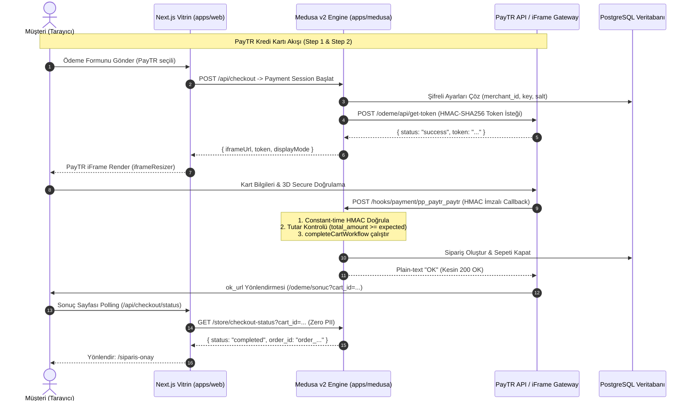

# Alte E-Ticaret Ödeme Mimarisi (PayTR & Kapıda Ödeme)

Bu doküman, Alte CMS e-ticaret platformunda yer alan ödeme sağlayıcılarının mimarisini, veri akışlarını, şifreleme mekanizmalarını ve güvenlik kontrollerini açıklar.

---

## 1. Mimariye Genel Bakış

Sistem, Medusa v2'nin modüler Payment Provider mimarisi üzerine kuruludur. İki temel ödeme sağlayıcısı ve geliştirici ortamı için bir fallback sağlayıcı mevcuttur:

1. **PayTR Sağlayıcısı (`pp_paytr_paytr`):**

   - **Tip:** iFrame ve Yönlendirmeli (Redirect) Kredi/Banka Kartı Ödemesi.
   - **Akış:** İki adımlı güvenli ödeme (Step 1: Sunucu taraflı Token alma, Step 2: PayTR Webhook Callback).
   - **Destek:** Peşin ve Taksitli ödeme (admin panelinden taksit üst sınırı ayarlanabilir).
   - **Çevre:** Sandbox (Test) ve Canlı (Production) modları admin panelinden dinamik olarak yönetilir.

2. **Kapıda Ödeme Sağlayıcısı (`pp_cod_cod`):**

   - **Tip:** Teslimatta Nakit / Kredi Kartı ile Ödeme (Cash on Delivery).
   - **Hizmet Bedeli:** Dinamik olarak yönetilen hizmet bedeli (varsayılan 100 TL / 10.000 kuruş).
   - **Üst Limit:** Risk yönetimi amacıyla maksimum sepet tutarı sınırı (örn. 5.000 TL).

3. **Geliştirici Sahte Ödeme (`pp_system_default`):**
   - **Kısıtlama:** Yalnızca `NODE_ENV !== "production"` ve `ALLOW_DEV_PAYMENT="true"` iken vitrinde aktifleşebilir.
   - **Güvenlik Kapısı:** Medusa açılışında `productionPaymentGuard` loader'ı tarafından üretim ortamında fail-closed kuralıyla engellenir.

---

## 2. Veri ve Ödeme Akış Şeması (Mermaid)

---

## 3. Güvenlik ve Şifreleme Mimarisi

### 3.1 AES-256-GCM ile Veri Güvenliği

PayTR Merchant Key, Merchant Salt ve gelecekteki hassas kimlik bilgileri veritabanında asla açık metin (plaintext) olarak saklanmaz:

- **Algoritma:** `AES-256-GCM` (Kimlik doğrulamalı simetrik şifreleme).
- **Anahtar Türetme:** `SETTINGS_ENCRYPTION_KEY` ortam değişkeni (32 byte hex veya base64 string).
- **Format:** `iv:ciphertext:tag` (Her kayıt için 12-byte rastgele IV ve 16-byte GCM authentication tag).
- **Bütünlük Koruması:** Veritabanındaki şifreli metin harici müdahaleye uğrarsa, GCM tag doğrulaması hata verir ve fail-closed davranır.

### 3.2 Write-Only Admin UI ve Maskeleme

- Medusa Admin REST API (`GET /admin/payment-settings`) hassas anahtarları asla istemciye dönmez. Sadece son 4 karakteri gösteren maskeli format üretilir: `••••••••••••••••6789`.
- Ayarlar güncellenirken boş bırakılan veya maskeli gönderilen alanlar mevcut anahtarı korur (Write-Only form).

### 3.3 Sıfır Yeniden Başlatma (Zero Restart Registry)

- Ödeme ayarları güncellendiğinde Medusa sunucusunu yeniden başlatmaya gerek yoktur.
- `PaymentSettingsRegistry` sınıfı, güncel ayarları bellek içinde önbelleğe alır ve anında tüm isteklerde aktif hale getirir (10 dakika TTL ve veritabanı geri çekilme koruması).

### 3.4 PayTR Webhook Doğrulaması (Fail-Closed)

1. **Zaman Aşımına Dayanıklı Karşılaştırma:** Webhook hash doğrulaması `crypto.timingSafeEqual` kullanılarak yapılır; böylece side-channel / timing atakları engellenir.
2. **Strict Plain-Text "OK":** PayTR protokolü uyarınca bildirim alındığında yanıt gövdesi yalnızca ve kesinlikle `"OK"` (text/plain) olmalıdır. JSON veya HTML yanıt verilmesi durumunda PayTR bildirimi başarısız sayıp tekrar dener.
3. **Tutar Doğrulaması:** Callback gövdesindeki `total_amount` kuruş cinsinden sepetin beklenen tutarından küçükse işlem iptal edilir ve sipariş kesinlikle oluşturulmaz.
4. **İdempotency:** Aynı callback birden fazla kez ulaştığında (örneğin ağ gecikmesi nedeniyle), sistem sepetin zaten siparişe dönüştüğünü tespit eder ve mükerrer sipariş açmadan derhal `"OK"` döner.

---

## 4. Vitrin & CSP Yapılandırması

Next.js vitrin uygulamasında PayTR iFrame ve script entegrasyonu için Content Security Policy (CSP) kuralları `apps/web/next.config.ts` içinde yapılandırılmıştır:

- `frame-src 'self' https://www.paytr.com;`
- `script-src 'self' 'unsafe-inline' 'unsafe-eval' https://www.paytr.com;`
- `connect-src 'self' http://localhost:9000 http://127.0.0.1:9000 https://www.paytr.com;`
- `form-action 'self' https://www.paytr.com;`

---

## 5. Kapıda Ödeme (COD) İşleyişi

- Müşteri Kapıda Ödeme seçtiğinde, `pp_cod_cod` sağlayıcısı seçilir.
- Vitrin `CheckoutForm` bileşeni sepet özetinde Kapıda Ödeme Hizmet Bedelini dinamik satır olarak ekler ve toplamı günceller.
- Sipariş oluşturulduğunda metadata içerisine hizmet bedeli ve tutarı kaydedilir.
- Admin panelinde siparişin ödeme durumu "Awaiting Payment" olarak işaretlenir; kurye teslimatı sonrasında Medusa Admin üzerinden tahsilat kaydı (Capture) tamamlanır.
