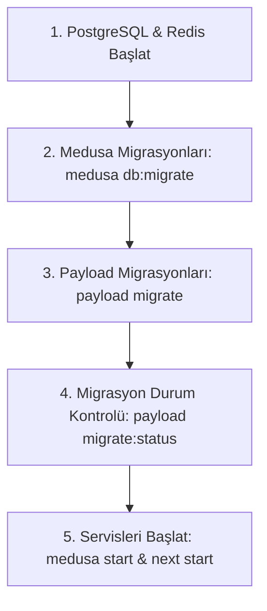

# Sistem Çalıştırma ve Dağıtım Rehberi (RUNBOOK.md)

Bu doküman, üretim ve yerel ortamlarda sistemin sıfırdan kurulumu, veritabanı migrasyonlarının yürütülme sırası ve servis başlatma adımlarını açıklar.

---

## 1. Üretim Dağıtım Sıralaması (Production Deployment Sequence)

Üretim ortamında (`NODE_ENV=production`) Payload CMS ve Medusa v2 otomatik şema gönderimini (auto-push) kesinlikle çalıştırmaz. Tüm veritabanı tabloları deterministik migrasyon dosyaları üzerinden ayağa kaldırılmalıdır.

Doğru başlatma sıralaması istisnasız aşağıdaki gibidir:



### Adım Adım Komutlar:

#### 1. Altyapı Hazırlığı:

PostgreSQL ve Redis servislerinin hazır ve bağlantı kabul eder durumda olduğunu doğrulayın.

#### 2. Medusa v2 Migrasyonları:

```bash
pnpm --filter @alte/medusa db:migrate
# veya kök dizinden:
pnpm migrate:medusa
```

_Bu adım e-ticaret tablolarını, ödeme sağlayıcılarını (`payment_setting`), e-posta bildirim tablolarını (`email_setting`, `email_log`) ve arama indekslerini (`search-indexes` modülü: `idx_product_title_trgm`, `idx_product_subtitle_trgm`, `idx_product_status`) oluşturur._

> **Önemli — `pg_trgm` ve `unaccent` Eklenti Yetkileri (Non-Superuser DB Kullanıcısı):**
> PostgreSQL'de `CREATE EXTENSION` komutu varsayılan olarak veritabanı sahibi (`CREATE` yetkili) veya `SUPERUSER` rolü gerektirir. Üretim ortamında uygulama kullanıcısı (`medusa_user`) kısıtlı yetkiye sahipse:
>
> 1. Migrasyon (`apps/medusa/src/modules/search-indexes/migrations/Migration20261110120000.ts`) ve açılış yükleyicisi (`apps/medusa/src/loaders/search-indexes.ts`) `insufficient_privilege` hatasını yakalar, süreci çökertmeden uyarı/hata logu (`Runbook: docs/RUNBOOK.md`) üretir.
> 2. Dağıtımdan (`medusa db:migrate`) **önce** veritabanı yöneticisi (DBA / `postgres` superuser) hedef veritabanında eklentileri bir kez manuel oluşturmalıdır:
>    ```sql
>    -- Superuser (postgres) olarak medusa_db üzerinde çalıştırın:
>    CREATE EXTENSION IF NOT EXISTS pg_trgm;
>    CREATE EXTENSION IF NOT EXISTS unaccent;
>    ```
> 3. Eklentiler önceden kurulduğunda `CREATE EXTENSION IF NOT EXISTS` adımı yetki hatası vermez ve `medusa_user` kendi sahibi olduğu `product` tablosu üzerinde `idx_product_title_trgm`, `idx_product_subtitle_trgm` ve `idx_product_status` indekslerini sorunsuz oluşturur.

#### 3. Payload CMS Migrasyonları:

```bash
pnpm --filter @alte/web migrate
# veya kök dizinden:
pnpm migrate:payload
```

_Bu adım içerik yönetim tablolarını (`pages`, `posts`, `media`, `users`, `site_settings`, `navigation`, `payload_migrations`) oluşturur._

#### 4. Migrasyon Durumunu Doğrulama:

```bash
pnpm --filter @alte/web migrate:status
# veya kök dizinden:
pnpm migrate:payload:status
```

_Bekleyen (pending) migrasyon olmadığını ve tüm migrasyonların batch numarasıyla işlendiğini teyit eder._

#### 5. Servisleri Başlatma:

```bash
# Medusa v2 Backend (Port 9000):
pnpm --filter @alte/medusa start

# Next.js 15 Storefront & Payload Admin (Port 3100):
pnpm --filter @alte/web start
```

---

## 2. Şema Değişikliği ve Yeni Migrasyon Oluşturma (Geliştirici Rehberi)

1. Geliştirme ortamında (`NODE_ENV=development`) `push: true` etkindir; koleksiyonlara eklenen yeni alanlar yerel veritabanına anında yansır.
2. Değişiklikler tamamlandığında deterministik üretim migrasyonu oluşturun:
   ```bash
   pnpm --filter @alte/web payload migrate:create <migrasyon_adi>
   ```
3. Oluşturulan TypeScript migrasyon dosyası (`apps/web/src/migrations/YYYYMMDD_HHMMSS_<migrasyon_adi>.ts`), şema anlık görüntüsü (`.json`) ve güncellenen `apps/web/src/migrations/index.ts` dosyalarını commit'e dahil edin.
4. Şema senkronizasyon dosyasını güncelleyin:
   ```bash
   pnpm --filter @alte/web exec payload generate:db-schema
   ```
5. CI hattı hem boş veritabanında migrasyonları uygular hem de koleksiyonlar ile migrasyon dosyalarının birebir senkron olduğunu denetler. Unutulan migrasyonlarda CI kırmızı olur.

---

## 3. Önbellek Stratejisi ve `revalidateTag` Yönetimi (Caching & Invalidation)

Next.js 15 App Router üzerinde sayfa ve veri önbelleklemesi etiket (tag) tabanlı ISR (Incremental Static Regeneration) mimarisiyle yürütülür:

### Desteklenen Önbellek Etiketleri (Cache Tags):

- `products`: Tüm ürün listesi ve vitrin ürün gridi
- `product-[handle]`: İlgili ürünün detay sayfası
- `categories`: Kategori ağacı ve navigasyon bağlantıları
- `category-[slug]`: İlgili kategori ürün listesi
- `blog`: Blog listesi ve kategori filtreleri
- `post-[slug]`: İlgili blog yazısının detay sayfası
- `pages`: Genel statik ve Puck ile oluşturulan sayfalar
- `page-[slug]`: İlgili sayfa içeriği
- `navigation`: Üst menü ve alt bilgi (header/footer)
- `site-settings`: Mağaza başlığı, meta verileri ve genel ayarlar

### Geçersiz Kılma (Invalidation) Akışı:

1. **Payload İçerik Güncellemeleri:** `Pages` ve `Posts` koleksiyonlarında bir içerik yayınlandığında, güncellendiğinde veya silindiğinde `afterChange` ve `afterDelete` kancaları ilgili etiketi otomatik geçersiz kılar (`revalidateContentTag`).
2. **HTTP Revalidation Uç Noktası (`POST /api/revalidate`):**
   - Medusa ürün/fiyat/stok değişiklikleri veya dış sistem entegrasyonlarında çağrılır.
   - `x-revalidate-secret` başlığı (veya `PAYLOAD_SECRET`) ile korunur.
   - Örnek istek:
     ```bash
     curl -X POST http://localhost:3100/api/revalidate \
       -H "Content-Type: application/json" \
       -H "x-revalidate-secret: <PAYLOAD_SECRET>" \
       -d '{"tag": "products"}'
     ```
3. **Taslak Koruması:** Taslak (`_status: 'draft'`) ve önizleme sayfaları asla önbelleğe alınmaz (`revalidate: 0` ve dinamik sorgulama).

---

## 4. Canlı Doğrulama Paketleri (`pnpm verify:all`) ve CI `live-verify` İşi

Tüm fazların uçtan uca canlı HTTP doğrulama betikleri tek bir komut altında toplanmıştır:

```bash
pnpm verify:all
```

### Çalışma Sırası ve Günlükler:

1. `verify:store` (`scripts/verify-store.ts`)
2. `verify:storefront` (`scripts/verify-storefront.ts`)
3. `verify:checkout` (`scripts/verify-checkout.ts`) — Ana web sunucusu `next start` (production) modunda çalışıyorsa, `verify:all` geliştirici ödeme adımlarını doğrulamak için otomatik olarak boş bir portta (varsayılan `3101`) geçici bir `next dev` örneği başlatır ve adım bitince kapatır.
4. `verify:payments` (`scripts/verify-payments.ts`) — `PAYTR_API_BASE` üzerinde yerel sahte PayTR sunucusu açar ve HMAC / idempotency / recovery senaryolarını doğrular.
5. `verify:content` (`scripts/verify-content.ts`)
6. `verify:search` (`scripts/verify-search.ts`)
7. `verify:notifications` (`scripts/verify-notifications.ts`)
8. `verify:order-ops` (`scripts/verify-order-ops.ts`)
9. `verify:quality` (`scripts/verify-quality.ts`)
10. `verify:accounts` (`scripts/verify-accounts.ts`) — Müşteri hesabı kayıt, parola politikası, e-posta doğrulama, misafir sipariş birleştirme, giriş hız sınırı/numaralandırma koruması, çapraz müşteri IDOR engeli, şifre sıfırlama, CSRF/Origin koruması, çıkış oturum iptali, misafir sepet bağlama, hesap silme/anonimleştirme, legacy verifier kancası ve log PII taramasını canlı HTTP ile doğrular.
11. `verify-production-guard` (`scripts/verify-production-guard.ts`) — Rastgele boş bir port üzerinde `NODE_ENV=production` ile Medusa açılış korumalarını (Senaryo a, b, c, d) sınar ve sonunda geliştirici ödeme sağlayıcılarını geri yükler.

- Her betiğin ham çıktısı `verify-logs/<betik>.log` dosyasına, özet tablosu ise `verify-logs/SUMMARY.md` dosyasına yazılır (`verify-logs/` dizini `.gitignore` içindedir).
- Bir betik başarısız olsa bile kalan betikler çalışmaya devam eder; en sonda herhangi biri sıfır olmayan kod döndürdüyse `pnpm verify:all` çıkış kodu `1` ile sonlanır.
- CI'daki `live-verify` işi (`ubuntu-latest`), temiz `postgres:16-alpine` ve `redis:7-alpine` servis konteynerleri üzerinde migrasyonları, mağaza kurulumunu ve tohumlamayı (`setup:store`, `seed:promotions`, `seed:content`, `seed:fake`) çalıştırır, Medusa ve Web sunucularını arka planda başlatır, `REQUIRE_LIVE_SERVER=true` ile canlı tarayıcı testlerini (`a11y-axe`, `keyboard-nav`, `responsive-pagination`, `shipping-selection`) ve ardından `pnpm verify:all` komutunu koşturur; oluşan `verify-logs/` klasörünü her durumda (`if: always()`) CI artifact olarak yükler.

---

## 5. Checkout Eşzamanlılık Kilidi (`CheckoutConcurrencyGuard`) ve Süreç İçi Sınırlar

`apps/web/src/app/api/checkout/route.ts` uç noktasında aynı sepet için paralel gelen sipariş tamamlama isteklerini (`[200, 409]`) korumak amacıyla `apps/web/src/lib/medusa/cart-checkout-guard.ts` içindeki `CheckoutConcurrencyGuard` kullanılır:

- **`inFlightCartCheckouts` (`Set<string>`):** Devam eden checkout isteği süresince sepeti kilitler ve `try ... finally` bloğu içinde her durumda temizlenir.
- **`completedCartOrders` (`Map<string, { orderId, completedAt }>`):** Tamamlanan sepet kayıtlarını **1 saat TTL** (`3_600_000 ms`) ve **en fazla 5000 kayıt** sınırıyla bellekte tutar (kapasite dolduğunda en eski kayıt FIFO sırasıyla silinir, bellek sızıntısı önlenir).
- **Mimari Not (Çoklu Süreç / Multi-Instance Uyarısı):** Bu kilit **süreç içi (in-process)** bellek üzerinde çalışır. Tek bir `next start` sürecinde eşzamanlı yarış durumlarını kesinkes engeller; ancak birden fazla Next.js sunucu örneği (cluster / yatay ölçekleme) çalıştırılacaksa, süreç içi kilit örnekler arasında paylaşılmaz (Faz 13 kapsamında hız sınırları ve kilitlerin Redis'e taşınması planlanmıştır). Üretimde Medusa veritabanı seviyesindeki sepet tamamlama kontrolü ikincil koruma katmanı olarak görev yapar.
