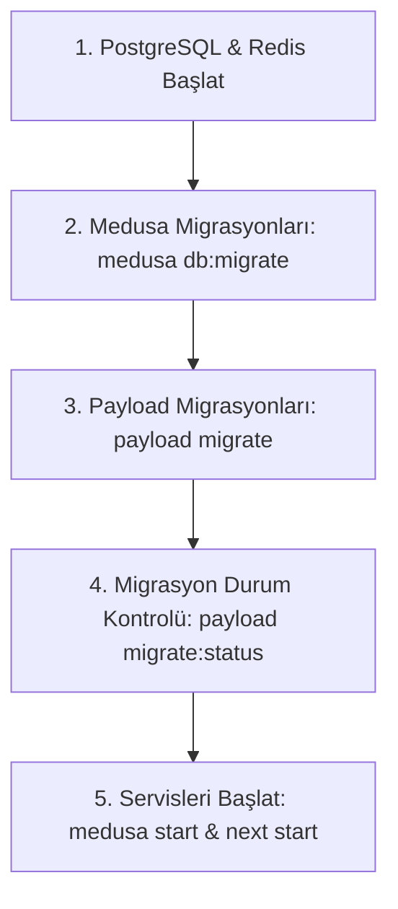

# Sistem Çalıştırma ve Dağıtım Rehberi (RUNBOOK.md)

Bu doküman, üretim ve yerel ortamlarda sistemin sıfırdan kurulumu, veritabanı migrasyonlarının yürütülme sırası ve servis başlatma adımlarını açıklar.

---

## 1. Üretim Dağıtım Sıralaması (Production Deployment Sequence)

Üretim ortamında (`NODE_ENV=production`) Payload CMS ve Medusa v2 otomatik şema gönderimini (auto-push) kesinlikle çalıştırmaz. Tüm veritabanı tabloları deterministik migrasyon dosyaları üzerinden ayağa kaldırılmalıdır.

Doğru başlatma sıralaması istisnasız aşağıdaki gibidir:



### Adım Adım Komutlar:

#### 1. Altyapı Hazırlığı:

PostgreSQL ve Redis servislerinin hazır ve bağlantı kabul eder durumda olduğunu doğrulayın.

#### 2. Medusa v2 Migrasyonları:

```bash
pnpm --filter @alte/medusa db:migrate
# veya kök dizinden:
pnpm migrate:medusa
```

_Bu adım e-ticaret tablolarını, ödeme sağlayıcılarını (`payment_setting`), e-posta bildirim tablolarını (`email_setting`, `email_log`) ve ilgili indeksleri oluşturur._

#### 3. Payload CMS Migrasyonları:

```bash
pnpm --filter @alte/web migrate
# veya kök dizinden:
pnpm migrate:payload
```

_Bu adım içerik yönetim tablolarını (`pages`, `posts`, `media`, `users`, `site_settings`, `navigation`, `payload_migrations`) oluşturur._

#### 4. Migrasyon Durumunu Doğrulama:

```bash
pnpm --filter @alte/web migrate:status
# veya kök dizinden:
pnpm migrate:payload:status
```

_Bekleyen (pending) migrasyon olmadığını ve tüm migrasyonların batch numarasıyla işlendiğini teyit eder._

#### 5. Servisleri Başlatma:

```bash
# Medusa v2 Backend (Port 9000):
pnpm --filter @alte/medusa start

# Next.js 15 Storefront & Payload Admin (Port 3100):
pnpm --filter @alte/web start
```

---

## 2. Şema Değişikliği ve Yeni Migrasyon Oluşturma (Geliştirici Rehberi)

1. Geliştirme ortamında (`NODE_ENV=development`) `push: true` etkindir; koleksiyonlara eklenen yeni alanlar yerel veritabanına anında yansır.
2. Değişiklikler tamamlandığında deterministik üretim migrasyonu oluşturun:
   ```bash
   pnpm --filter @alte/web payload migrate:create <migrasyon_adi>
   ```
3. Oluşturulan TypeScript migrasyon dosyası (`apps/web/src/migrations/YYYYMMDD_HHMMSS_<migrasyon_adi>.ts`), şema anlık görüntüsü (`.json`) ve güncellenen `apps/web/src/migrations/index.ts` dosyalarını commit'e dahil edin.
4. Şema senkronizasyon dosyasını güncelleyin:
   ```bash
   pnpm --filter @alte/web exec payload generate:db-schema
   ```
5. CI hattı hem boş veritabanında migrasyonları uygular hem de koleksiyonlar ile migrasyon dosyalarının birebir senkron olduğunu denetler. Unutulan migrasyonlarda CI kırmızı olur.
