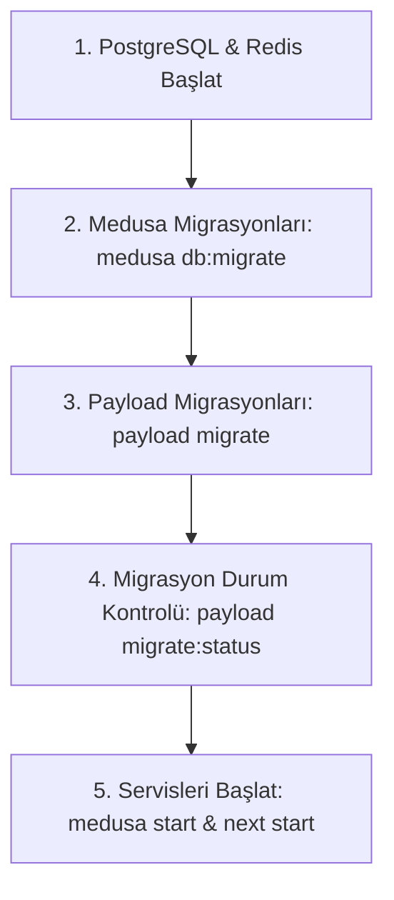

# Sistem Çalıştırma ve Dağıtım Rehberi (RUNBOOK.md)

Bu doküman, üretim ve yerel ortamlarda sistemin sıfırdan kurulumu, veritabanı migrasyonlarının yürütülme sırası ve servis başlatma adımlarını açıklar.

---

## 1. Üretim Dağıtım Sıralaması (Production Deployment Sequence)

Üretim ortamında (`NODE_ENV=production`) Payload CMS ve Medusa v2 otomatik şema gönderimini (auto-push) kesinlikle çalıştırmaz. Tüm veritabanı tabloları deterministik migrasyon dosyaları üzerinden ayağa kaldırılmalıdır.

Doğru başlatma sıralaması istisnasız aşağıdaki gibidir:



### Adım Adım Komutlar:

#### 1. Altyapı Hazırlığı:

PostgreSQL ve Redis servislerinin hazır ve bağlantı kabul eder durumda olduğunu doğrulayın.

#### 2. Medusa v2 Migrasyonları:

```bash
pnpm --filter @alte/medusa db:migrate
# veya kök dizinden:
pnpm migrate:medusa
```

_Bu adım e-ticaret tablolarını, ödeme sağlayıcılarını (`payment_setting`), e-posta bildirim tablolarını (`email_setting`, `email_log`) ve arama indekslerini (`search-indexes` modülü: `idx_product_title_trgm`, `idx_product_subtitle_trgm`, `idx_product_status`) oluşturur._

> **Önemli — `pg_trgm` ve `unaccent` Eklenti Yetkileri (Non-Superuser DB Kullanıcısı):**
> PostgreSQL'de `CREATE EXTENSION` komutu varsayılan olarak veritabanı sahibi (`CREATE` yetkili) veya `SUPERUSER` rolü gerektirir. Üretim ortamında uygulama kullanıcısı (`medusa_user`) kısıtlı yetkiye sahipse:
>
> 1. Migrasyon (`apps/medusa/src/modules/search-indexes/migrations/Migration20261110120000.ts`) ve açılış yükleyicisi (`apps/medusa/src/loaders/search-indexes.ts`) `insufficient_privilege` hatasını yakalar, süreci çökertmeden uyarı/hata logu (`Runbook: docs/RUNBOOK.md`) üretir.
> 2. Dağıtımdan (`medusa db:migrate`) **önce** veritabanı yöneticisi (DBA / `postgres` superuser) hedef veritabanında eklentileri bir kez manuel oluşturmalıdır:
>    ```sql
>    -- Superuser (postgres) olarak medusa_db üzerinde çalıştırın:
>    CREATE EXTENSION IF NOT EXISTS pg_trgm;
>    CREATE EXTENSION IF NOT EXISTS unaccent;
>    ```
> 3. Eklentiler önceden kurulduğunda `CREATE EXTENSION IF NOT EXISTS` adımı yetki hatası vermez ve `medusa_user` kendi sahibi olduğu `product` tablosu üzerinde `idx_product_title_trgm`, `idx_product_subtitle_trgm` ve `idx_product_status` indekslerini sorunsuz oluşturur.

#### 3. Payload CMS Migrasyonları:

```bash
pnpm --filter @alte/web migrate
# veya kök dizinden:
pnpm migrate:payload
```

_Bu adım içerik yönetim tablolarını (`pages`, `posts`, `media`, `users`, `site_settings`, `navigation`, `payload_migrations`) oluşturur._

#### 4. Migrasyon Durumunu Doğrulama:

```bash
pnpm --filter @alte/web migrate:status
# veya kök dizinden:
pnpm migrate:payload:status
```

_Bekleyen (pending) migrasyon olmadığını ve tüm migrasyonların batch numarasıyla işlendiğini teyit eder._

#### 5. Servisleri Başlatma:

```bash
# Medusa v2 Backend (Port 9000):
pnpm --filter @alte/medusa start

# Next.js 15 Storefront & Payload Admin (Port 3100):
pnpm --filter @alte/web start
```

---

## 2. Şema Değişikliği ve Yeni Migrasyon Oluşturma (Geliştirici Rehberi)

1. Geliştirme ortamında (`NODE_ENV=development`) `push: true` etkindir; koleksiyonlara eklenen yeni alanlar yerel veritabanına anında yansır.
2. Değişiklikler tamamlandığında deterministik üretim migrasyonu oluşturun:
   ```bash
   pnpm --filter @alte/web payload migrate:create <migrasyon_adi>
   ```
3. Oluşturulan TypeScript migrasyon dosyası (`apps/web/src/migrations/YYYYMMDD_HHMMSS_<migrasyon_adi>.ts`), şema anlık görüntüsü (`.json`) ve güncellenen `apps/web/src/migrations/index.ts` dosyalarını commit'e dahil edin.
4. Şema senkronizasyon dosyasını güncelleyin:
   ```bash
   pnpm --filter @alte/web exec payload generate:db-schema
   ```
5. CI hattı hem boş veritabanında migrasyonları uygular hem de koleksiyonlar ile migrasyon dosyalarının birebir senkron olduğunu denetler. Unutulan migrasyonlarda CI kırmızı olur.

---

## 3. Önbellek Stratejisi ve `revalidateTag` Yönetimi (Caching & Invalidation)

Next.js 15 App Router üzerinde sayfa ve veri önbelleklemesi etiket (tag) tabanlı ISR (Incremental Static Regeneration) mimarisiyle yürütülür:

### Desteklenen Önbellek Etiketleri (Cache Tags):

- `products`: Tüm ürün listesi ve vitrin ürün gridi
- `product-[handle]`: İlgili ürünün detay sayfası
- `categories`: Kategori ağacı ve navigasyon bağlantıları
- `category-[slug]`: İlgili kategori ürün listesi
- `blog`: Blog listesi ve kategori filtreleri
- `post-[slug]`: İlgili blog yazısının detay sayfası
- `pages`: Genel statik ve Puck ile oluşturulan sayfalar
- `page-[slug]`: İlgili sayfa içeriği
- `navigation`: Üst menü ve alt bilgi (header/footer)
- `site-settings`: Mağaza başlığı, meta verileri ve genel ayarlar

### Geçersiz Kılma (Invalidation) Akışı:

1. **Payload İçerik Güncellemeleri:** `Pages` ve `Posts` koleksiyonlarında bir içerik yayınlandığında, güncellendiğinde veya silindiğinde `afterChange` ve `afterDelete` kancaları ilgili etiketi otomatik geçersiz kılar (`revalidateContentTag`).
2. **HTTP Revalidation Uç Noktası (`POST /api/revalidate`):**
   - Medusa ürün/fiyat/stok değişiklikleri veya dış sistem entegrasyonlarında çağrılır.
   - `x-revalidate-secret` başlığı (veya `PAYLOAD_SECRET`) ile korunur.
   - Örnek istek:
     ```bash
     curl -X POST http://localhost:3100/api/revalidate \
       -H "Content-Type: application/json" \
       -H "x-revalidate-secret: <PAYLOAD_SECRET>" \
       -d '{"tag": "products"}'
     ```
3. **Taslak Koruması:** Taslak (`_status: 'draft'`) ve önizleme sayfaları asla önbelleğe alınmaz (`revalidate: 0` ve dinamik sorgulama).
